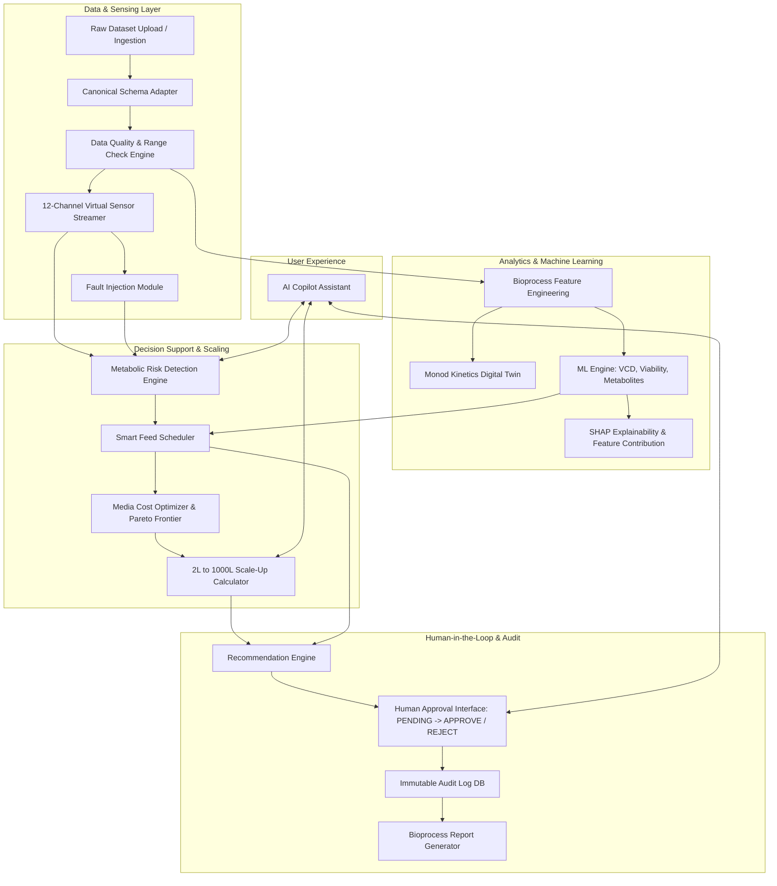

# BioCopilot System Architecture

BioCopilot is designed as an end-to-end, human-in-the-loop decision-support system for bioprocess development, scale-up, and risk detection.

## Modular Responsibilities

### Agent A: Data & Sensor Engine
- **Ingestion & Canonical Schema:** Standardizes raw CSV telemetry to 16 canonical attributes (`time_h`, `VCD`, `viability_pct`, `glucose_gL`, `lactate_gL`, `ammonia_mM`, `pH`, `DO_pct`, etc.).
- **Data Quality Engine:** Scores datasets based on completeness, physiological bounds ($pH \in [6.0, 8.0]$, $Viability \in [0, 100\%]$), duplicate detection, and interpolation integrity.
- **Virtual Sensor Suite:** Stream 12 simulated sensors over SSE / WebSocket every 2 seconds. Supports interactive fault injections (Glucose Overfeed, Lactate Rise, DO Crash).

### Agent B: Machine Learning & Optimization Engine
- **Bioprocess Feature Engineering:** Computes specific growth rate ($\mu$), substrate consumption rates ($q_s$), metabolite yields ($Y_{lac/glc}$), integrated VCD (IVCD), and rolling trends.
- **Predictive ML:** Batch-split XGBoost / Random Forest regression predicting future VCD, viability, lactate, and ammonia over 24h/48h horizons with uncertainty intervals.
- **Explainability (SHAP):** Calculates feature impact matrices and explicitly labels model correlation vs biological causation.
- **Smart Feed & Cost Optimizer:** Evaluates nutrient scenarios (Deficient, Optimal, Excess) and performs multi-objective Pareto optimization balancing growth vs media cost (INR/USD).

### Agent C: Scale-Up Engine
- **Bioreactor Scaling (2 L → 10 L → 100 L → 1,000 L):** Solves engineering correlations under 4 scaling strategies:
  1. Constant Power/Volume ($P/V$)
  2. Constant Impeller Tip Speed ($v_t$)
  3. Constant Mass Transfer Coefficient ($k_L a$)
  4. Constant Mixing Time ($\tau_m$)
- Computes Reynolds Number ($Re$), shear risk index, DO limitation risks, and gas velocity limits. All outputs are strictly marked `ENGINEERING ESTIMATE — REQUIRES VALIDATION`.

### Agent D: FastAPI Backend & Audit Log
- **Pydantic Validation:** Type-safe HTTP and WebSocket endpoints.
- **Human-in-the-Loop Workflow:** Enforces manual review before any action. Tracks status (`PENDING`, `APPROVED`, `REJECTED`), operator ID, timestamp, and review rationale in SQLite audit tables.
- **Report Generator:** Exports complete bioprocess decision logs as formatted Markdown/PDF documents.

### Agent E: React Light-Theme Frontend
- **Laboratory Instrument Aesthetic:** Clean light-mode palette (slate, clinical white, emerald, indigo) with optional dark-mode toggle.
- **Interactive UI Components:** Real-time sensor monitors, Plotly interactive trend curves, what-if feed sliders, scale-up comparison matrices, risk center alerts, approval queue, and AI copilot drawer.
