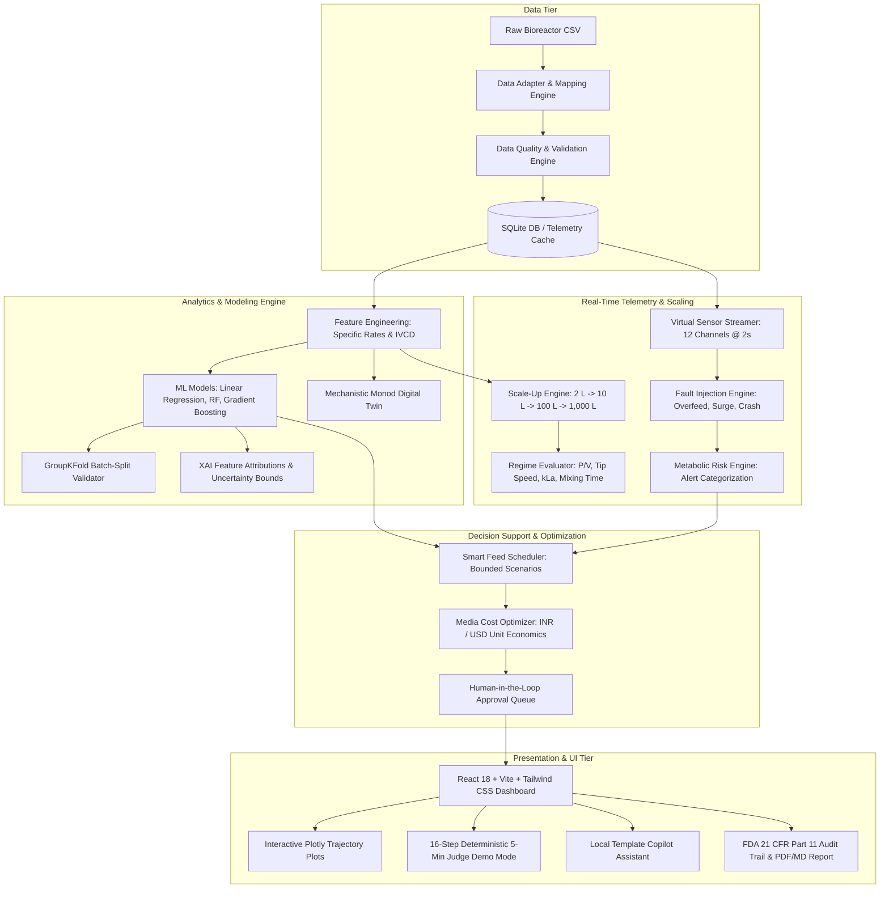

# BioCopilot: System Architecture & Data Flow

---

## Component Breakdown

1. **Data Tier:** Ingests raw cell culture time-series data, maps columns via fuzzy matching, applies physiological range bounds, and computes a transparent 0-100 data quality score.
2. **Analytics & Modeling Engine:** Derives physiological rates ($q_{glc}, q_{lac}, \mu$), computes cumulative biomass integrals ($IVCD$), and executes multi-horizon forecasting using regressors evaluated on unseen batch holdouts.
3. **Telemetry & Scaling:** Emits 12 bioprocess channels over WebSockets at 2.0-second intervals, injects perturbations on command, and evaluates hydrodynamic scale-up trade-offs across 4 industrial regimes.
4. **Decision Support & Approval:** Generates bounded feeding scenarios, models media formulation economics, and directs all recommendations into an approval gate requiring human sign-off.
5. **Presentation Layer:** Glassmorphic laboratory instrument theme with Plotly scientific visualizations and an automated 16-step guided demo mode.
