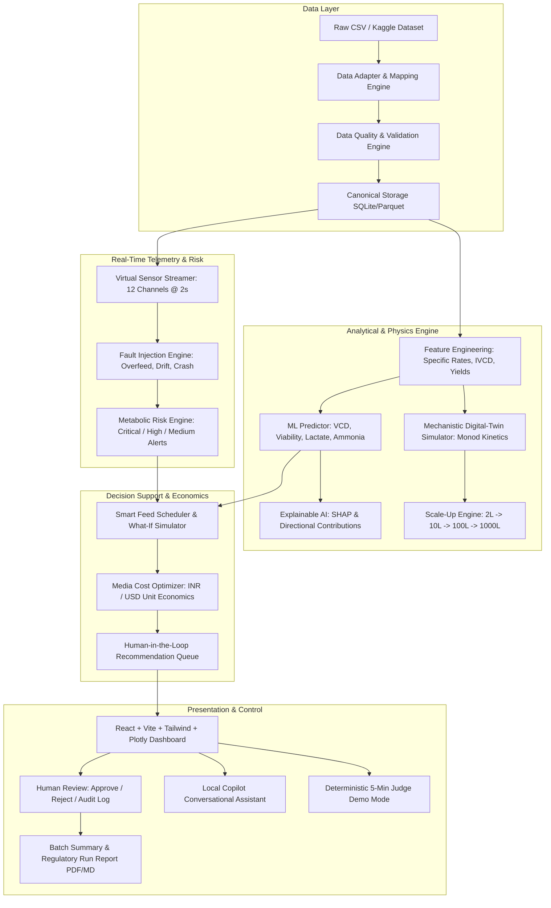

# BioCopilot: AI Copilot for Scalable Cell-Culture Bioprocess Design
## Implementation Plan & System Architecture

**Target Event:** YUVA Megathon 2026 — SRM IST Trichy — Biotech Track  
**Core Positioning:** *"From cell-culture data to explainable process decisions — detect metabolic risk, predict process behavior, optimize nutrients and cost, and evaluate scale-up from 2 L toward 1,000 L."*  
**System Nature:** Decision-support system with mandatory human approval workflow. Never directly controls equipment.

---

## 1. System Architecture



---

## 2. Technology Stack

### Backend
* **Language & Runtime:** Python 3.11+
* **Web Framework:** FastAPI (async REST + WebSocket)
* **Data & Physics Processing:** Pandas, NumPy, SciPy (odeint for Monod kinetic differential equations)
* **Machine Learning:** scikit-learn (RandomForestRegressor, GradientBoostingRegressor, LinearRegression baseline), SHAP/TreeExplainer
* **Database & ORM:** SQLite with SQLAlchemy & Alembic-compatible schema
* **Validation:** Pydantic v2 data models
* **Testing:** Pytest with end-to-end integration and mathematical property validation

### Frontend
* **Core:** React 18+ with TypeScript
* **Build System:** Vite
* **Styling:** Tailwind CSS + Glassmorphic Dark "Industrial Laboratory Instrument" Theme with Light Mode toggle
* **Interactive Scientific Visualizations:** Plotly.js / React-Plotly + Lucide React Icons
* **Routing:** React Router v6
* **State Management:** Reactive Hooks + WebSocket client for live telemetry replay

---

## 3. Directory & Folder Structure

```
biocopilot/
├── backend/
│   ├── app/
│   │   ├── api/
│   │   │   ├── routes_datasets.py
│   │   │   ├── routes_sensors.py
│   │   │   ├── routes_predictions.py
│   │   │   ├── routes_optimization.py
│   │   │   ├── routes_scaleup.py
│   │   │   ├── routes_recommendations.py
│   │   │   ├── routes_copilot.py
│   │   │   └── routes_reports.py
│   │   ├── database/
│   │   │   ├── database.py
│   │   │   └── models.py
│   │   ├── ml/
│   │   │   ├── trainer.py
│   │   │   ├── predictors.py
│   │   │   ├── explainability.py
│   │   │   └── feature_engineering.py
│   │   ├── models/
│   │   ├── schemas/
│   │   │   ├── canonical.py
│   │   │   └── api_schemas.py
│   │   ├── services/
│   │   │   ├── data_cleaner.py
│   │   │   ├── data_quality.py
│   │   │   ├── risk_engine.py
│   │   │   ├── feed_scheduler.py
│   │   │   ├── cost_optimizer.py
│   │   │   └── report_generator.py
│   │   ├── simulators/
│   │   │   ├── digital_twin.py
│   │   │   ├── sensor_streamer.py
│   │   │   └── scaleup_engine.py
│   │   ├── utils/
│   │   └── main.py
│   └── tests/
│       ├── test_data_cleaning.py
│       ├── test_feature_engineering.py
│       ├── test_ml_models.py
│       ├── test_risk_engine.py
│       ├── test_scaleup.py
│       └── test_api_endpoints.py
├── frontend/
│   ├── src/
│   │   ├── api/
│   │   ├── components/
│   │   │   ├── Navbar.tsx
│   │   │   ├── MetricCard.tsx
│   │   │   ├── LimitationsBanner.tsx
│   │   │   ├── FaultInjectorModal.tsx
│   │   │   ├── ApprovalModal.tsx
│   │   │   └── CopilotChatDrawer.tsx
│   │   ├── charts/
│   │   │   ├── ProcessTrendsPlot.tsx
│   │   │   ├── RiskTimelineChart.tsx
│   │   │   ├── ShapWaterfallChart.tsx
│   │   │   ├── ScaleupComparisonPlot.tsx
│   │   │   └── CostBreakdownBar.tsx
│   │   ├── pages/
│   │   │   ├── OverviewDashboard.tsx
│   │   │   ├── DataIngestionQuality.tsx
│   │   │   ├── LiveSensorMonitor.tsx
│   │   │   ├── PredictionsExplainability.tsx
│   │   │   ├── NutrientFeedOptimizer.tsx
│   │   │   ├── MediaCostAnalysis.tsx
│   │   │   ├── ScaleUpEnginePage.tsx
│   │   │   ├── RiskCenterPage.tsx
│   │   │   ├── AuditApprovalPage.tsx
│   │   │   └── DemoModeRunner.tsx
│   │   ├── types/
│   │   └── App.tsx
├── data/
│   ├── raw/
│   ├── processed/
│   ├── reference/
│   └── demo/
│       └── verified_cell_culture_batches.csv
├── config/
│   └── data_source.yaml
├── docs/
│   ├── implementation_plan.md
│   ├── api_contract.md
│   ├── data_quality_report.md
│   ├── demo_script.md
│   ├── limitations.md
│   └── walkthrough.md
├── Makefile
├── docker-compose.yml
├── Dockerfile
└── README.md
```

---

## 4. Data Pipeline & Canonical Schema

Every dataset is mapped and transformed into the canonical schema:
1. `time_h` (float) - Culture duration in hours
2. `batch_id` (str) - Run identifier
3. `vessel_volume_L` (float) - Working volume
4. `VCD` (float) - Viable Cell Density (10^6 cells/mL)
5. `viability_pct` (float) - Percent cell viability (0-100%)
6. `glucose_gL` (float) - Glucose concentration (g/L)
7. `glutamine_mM` (float) - Glutamine concentration (mM)
8. `lactate_gL` (float) - Lactate concentration (g/L)
9. `ammonia_mM` (float) - Ammonia concentration (mM)
10. `pH` (float) - Culture pH
11. `DO_pct` (float) - Dissolved oxygen percentage
12. `temp_C` (float) - Temperature in Celsius
13. `rpm` (float) - Agitation speed
14. `gas_flow_vvm` (float) - Aeration gas flow in vvm
15. `feed_rate_mL_h` (float) - Continuous/bolus nutrient feed rate
16. `media_cost_per_L` (float) - Medium formulation cost per liter

### Data Quality Rules
* Missing value threshold reporting (never fabricate values; show explicit "Not available in source data").
* Physiological boundary validation:
  - pH: [6.4, 7.8]
  - Viability: [0, 100] %
  - Temp: [30.0, 40.0] °C
  - DO: [0, 150] %
* Data Quality Score: 0 to 100 calculated from completeness, consistency, range conformity, and sampling interval regularity.

---

## 5. Machine Learning & Uncertainty Engine

* **Batch-Split Cross Validation:** GroupKFold on `batch_id` to strictly prevent temporal leakage across runs.
* **Target Variables:**
  1. $VCD_{t + \Delta t}$
  2. $Viability_{t + \Delta t}$
  3. $Lactate_{t + \Delta t}$
  4. $Ammonia_{t + \Delta t}$
* **Engineered Features:**
  - Specific growth rate $\mu = \frac{1}{VCD}\frac{dVCD}{dt}$
  - Specific glucose uptake rate $q_{glc} = \frac{1}{VCD}\frac{d[Glc]}{dt}$
  - Specific lactate production rate $q_{lac} = \frac{1}{VCD}\frac{d[Lac]}{dt}$
  - Yield coefficient $Y_{lac/glc} = \Delta [Lac] / \Delta [Glc]$
  - Integral Viable Cell Density (IVCD) $= \int_0^t VCD(t) dt$
  - Rolling moving averages (3-point and 5-point trends)
* **Model Benchmark:** Linear Regression vs. Random Forest vs. Gradient Boosting with MAE, RMSE, and $R^2$.
* **Uncertainty Bounds:** Quantile regression / residual standard deviation yielding 95% confidence intervals $[y_{lower}, y_{upper}]$.
* **Explainability:** SHAP feature importance explaining individual predictions with distinct terminology emphasizing statistical association over biological causation.

---

## 6. Real-Time Telemetry & Fault Injection

* WebSocket stream `/ws/sensors` emitting 12 synchronized bioprocess channels at 2.0-second intervals.
* Replays historical or simulated runs with real-time rolling statistics and threshold monitoring.
* **Judge Fault Injections:**
  1. `Inject Lactate Rise`: Accelerated lactate accumulation indicating metabolic shift or overflow metabolism.
  2. `Inject Glucose Overfeed`: Excess glucose spike causing hyperosmolarity and increased lactate byproduct.
  3. `Inject DO Sensor Failure`: Drastic signal dropout / noise simulating sparger clog or polarographic probe drift.
  4. `Inject pH Drift`: Acidic or alkaline drift past regulatory CQA deadbands.
  5. `Inject Viability Crash`: Accelerated apoptotic descent triggering immediate critical intervention alerts.

---

## 7. Scale-Up Engineering Correlations (2 L → 1,000 L)

Supports scale stages: **2 L, 10 L, 100 L, 1,000 L** across 4 classic bioprocess scaling paradigms:
1. **Constant Power per Volume ($P/V$):** Maintains volumetric energy dissipation rate $\epsilon$.
2. **Constant Impeller Tip Speed ($v_{tip} = \pi \cdot N \cdot D$):** Controls maximum shear stress on mammalian cell membranes.
3. **Constant Volumetric Mass Transfer ($k_L a$):** Ensures oxygen transfer capability matching oxygen uptake rate ($OUR$).
   $$k_L a = k \cdot (P/V)^a \cdot (v_{gas})^b \quad (a=0.4, b=0.5)$$
4. **Constant Mixing Time ($\theta_m$):** Analyzes blend times and local nutrient/pH heterogeneity.

Each regime calculates:
- Impeller Speed ($N$, RPM)
- Tip Speed ($m/s$)
- Reynolds Number ($Re = \frac{\rho N D^2}{\mu_f}$)
- Gas Flow Rate ($vvm$ and $SLPM$)
- DO Limiting Risk & Shear Risk Assessment

---

## 8. Human-in-the-Loop & Audit Trail

Every AI recommendation moves through a deterministic approval state machine:
`GENERATED (TEST)` $\to$ `PENDING REVIEW` $\to$ `APPROVED / REJECTED` with mandatory operator comments and role verification.  
Audit log records:
- Timestamp (ISO 8601)
- Operator identifier
- State snapshot before action
- Proposed feed / parameter delta
- Predicted impact & confidence interval
- Final approval status & reasoning

---

## 9. Testing Strategy

1. **Unit Tests:** Data cleaner, column mapping dictionary, physiological range filters, feature derivation math.
2. **ML Tests:** GroupKFold batch separation, metric calculation accuracy, non-leakage guarantee.
3. **Physics Tests:** Scale-up equations, dimensional consistency, Monod kinetics mass balances.
4. **API Integration Tests:** Endpoint status codes, Pydantic schema validation, WebSocket message envelopes.
5. **E2E Demo Flow Test:** Verification that the 16-step 5-minute judge demo scenario completes deterministically.

---

## 10. Risk & Fallback Strategy

* **Sparse Dataset Fallback:** If experimental data lacks metabolite channels, activate the mechanistic Monod digital twin with explicit banner: *"DIGITAL TWIN APPROXIMATION — NOT GROUND TRUTH"*.
* **SHAP Performance Fallback:** If tree explainer generation exceeds 500ms, fall back to precomputed tree feature importances with directional sensitivity vectors.
* **WebSocket Disconnect:** Resilient auto-reconnect on frontend with cached last-known bioprocess state.
