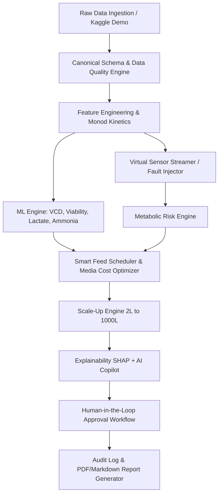

# BioCopilot Implementation Plan

## AI Copilot for Scalable Cell-Culture Bioprocess Design
**Target Event:** YUVA Megathon 2026 — SRM IST Trichy (Biotech Track)  
**Positioning:** Decision-Support System ("From cell-culture data to explainable process decisions")  
**Theme:** Light Mode (Clean Laboratory Instrument UI with option for Dark Mode)

---

## 1. Architecture Overview

BioCopilot is built as a micro-layered decision-support platform:
- **Data Engine:** Ingests raw cell culture time-series (CSV/JSON), standardizes schema, runs physiological quality checks, and generates process features.
- **Virtual Sensor & Fault Engine:** Replays batch telemetry over WebSocket/SSE (2-second interval) with interactive fault injection for judge demos.
- **Metabolic Risk & Machine Learning Engine:** Trains batch-split XGBoost / Random Forest models for VCD, viability, lactate, and ammonia prediction with SHAP/feature importance and uncertainty intervals.
- **Digital Twin Simulator:** Mechanistic Monod kinetic + oxygen transfer ODE simulator for what-if scenarios and feed schedule optimization.
- **Scale-Up Engine:** Chemical engineering scaling calculations (2 L → 10 L → 100 L → 1,000 L) under constant $P/V$, tip speed, $k_L a$, or mixing time.
- **Human-in-the-Loop & Audit Engine:** Every decision support recommendation transitions through `PENDING → APPROVED / REJECTED` with mandatory comments and immutable audit logging.

---

## 2. Technology Stack

- **Backend:** Python 3.11, FastAPI, Uvicorn, Pydantic v2, SQLite (via SQLAlchemy), Pandas, NumPy, SciPy, scikit-learn, XGBoost.
- **Real-Time Streaming:** WebSocket (`/ws/sensors`) & Server-Sent Events for virtual sensor telemetry.
- **Frontend:** React 18, TypeScript, Vite, Tailwind CSS, Lucide React Icons, Plotly.js / React-Plotly, HTML5 Canvas / SVG gauges.
- **Design Aesthetic:** Modern Light Theme ("Clean Clinical Laboratory Instrument"), featuring sleek cards, emerald/indigo accents, crisp typography, and light/dark theme toggle.

---

## 3. Data & Sensor Architecture

### Canonical Data Schema
Standardized fields:
- `time_h`, `batch_id`, `vessel_volume_L`, `VCD` ($10^6\text{ cells/mL}$), `viability_pct`, `glucose_gL`, `glutamine_mM`, `lactate_gL`, `ammonia_mM`, `pH`, `DO_pct`, `temp_C`, `rpm`, `gas_flow_vvm`, `feed_rate_mL_h`, `media_cost_per_L`.

### Virtual Sensors (12 Channels)
- SENSOR-01 (pH), SENSOR-02 (DO), SENSOR-03 (Temp), SENSOR-04 (Glucose), SENSOR-05 (Glutamine), SENSOR-06 (Lactate), SENSOR-07 (Ammonia), SENSOR-08 (VCD), SENSOR-09 (Viability), SENSOR-10 (RPM), SENSOR-11 (Gas Flow), SENSOR-12 (Feed Rate).

---

## 4. Scale-Up Engineering Correlations

1. **Power Input ($P$):** $P = N_p \cdot \rho \cdot N^3 \cdot D^5$
2. **Volumetric Power ($P/V$):** $\frac{P}{V} = \frac{N_p \rho N^3 D^5}{V}$
3. **Tip Speed ($v_t$):** $v_t = \pi \cdot N \cdot D$
4. **Oxygen Mass Transfer ($k_L a$):** $k_L a = k \cdot (P/V)^a \cdot (v_{vs})^b \quad (a=0.4, b=0.5)$
5. **Mixing Time ($\tau_m$):** Estimated via impeller flow number and reactor geometry.

---

## 5. Demo & Validation Workflow (5-Min Judge Demo)

1. Load Verified Demo Batch Data.
2. View Data Quality Scorecard & Canonical Mapping.
3. Start Simulated Sensor Replay.
4. Trigger Fault Injection: "Inject Glucose Overfeed" / "Inject Lactate Rise".
5. Observe Metabolic Risk Alert & SHAP Explainability.
6. Run Smart Feed What-If Optimization & Media Cost Comparison.
7. Run 2 L → 1,000 L Scale-Up Scenarios (Constant $P/V$ vs Constant $k_L a$).
8. Submit Recommendation to Human Approval Queue (`APPROVE` / `REJECT`).
9. Generate Bioprocess Decision Report.

---

## 6. Risk Mitigation & Fallback Strategy

- **If Real Dataset Missing:** Use pre-packaged CHO cell fed-batch dataset (`/data/demo/cho_fedbatch_demo.csv`) clearly tagged `SYNTHETIC DEMO DATA — NOT EXPERIMENTAL DATA`.
- **If XGBoost/SHAP Slow:** Fallback to Random Forest / linear tree model with explicit feature importance matrix.
- **If LLM API Unreachable:** Built-in rule-based bioprocess context parser answers all preset copilot queries with 100% reliability.
